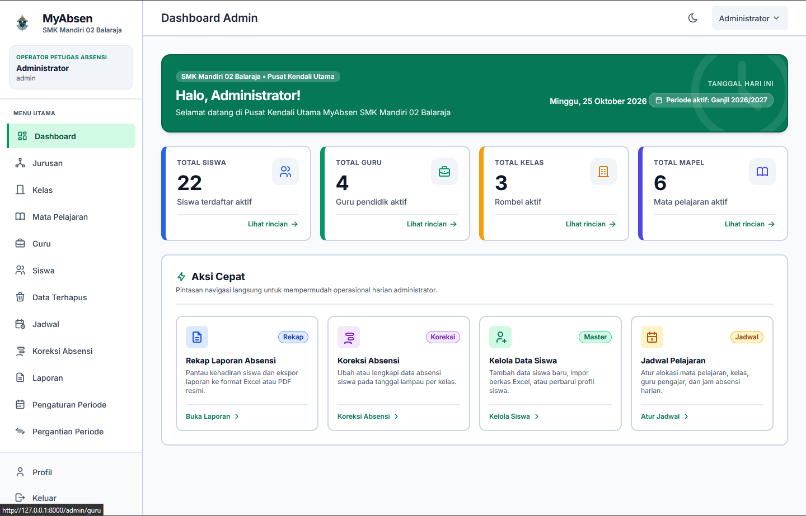
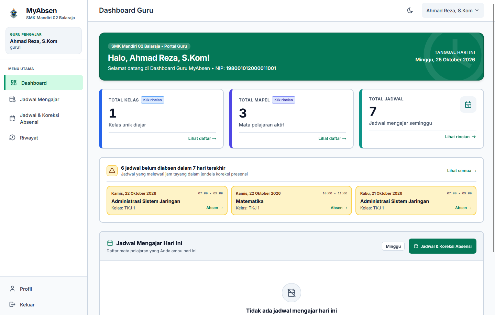
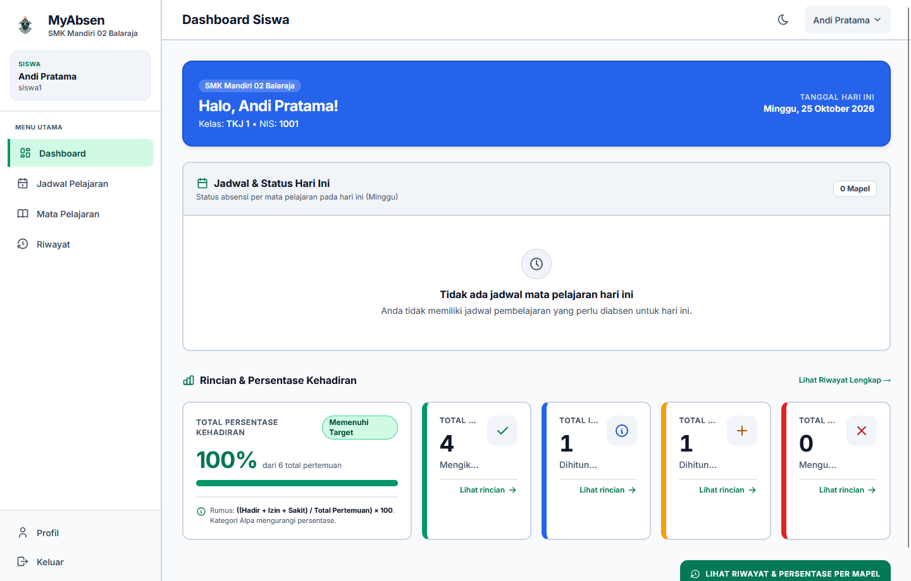

# MyAbsen

> **Aplikasi Absensi Siswa per Mata Pelajaran untuk SMK**

MyAbsen adalah sistem informasi absensi siswa berbasis web yang dirancang khusus untuk Sekolah Menengah Kejuruan (SMK) sebagai proyek PKM. Berbeda dengan absensi harian biasa, sistem ini mencatat kehadiran **per mata pelajaran**, memungkinkan pelacakan kehadiran siswa di setiap jam pelajaran secara akurat.

---

## Daftar Isi
- [Fitur Utama](#fitur-utama)
- [Preview Tampilan](#preview-tampilan)
- [Panduan Pengguna](#panduan-pengguna)
- [Teknologi](#teknologi)
- [Konvensi Tampilan](#konvensi-tampilan)
- [Panduan Instalasi Lokal](#panduan-instalasi-lokal)
- [Kredensial Demo](#kredensial-demo)
- [Setelah git pull](#setelah-git-pull)
- [Pengujian](#pengujian)
- [Perintah Penting](#perintah-penting)
- [Panduan Seeder & Migrasi (Lokal vs Produksi)](#panduan-seeder--migrasi-lokal-vs-produksi)
- [Variabel Environment Tambahan (.env)](#variabel-environment-tambahan-env)
- [Struktur Folder Proyek](#struktur-folder-proyek)
- [Batasan yang Diketahui dan Catatan Serah Terima](#batasan-yang-diketahui-dan-catatan-serah-terima)
- [Pemecahan Masalah](#pemecahan-masalah)
- [Dokumentasi Proyek](#dokumentasi-proyek)
- [Alur Kerja Tim](#alur-kerja-tim)

---

## Fitur Utama

Aplikasi ini memiliki tiga peran pengguna dengan batasan akses masing-masing:

### Fitur Lintas Peran
- **Otentikasi Fleksibel:** Pengguna dapat masuk menggunakan Username, NIP (Guru), atau NIS (Siswa).
- **Aksesibilitas Visual:** Dilengkapi tombol alih Mode Terang dan Mode Gelap (*Light/Dark Mode*) berbasis token desain terpusat (bawaan: Mode Terang).
- **Keamanan Akun:** Wajib mengganti password saat pertama kali masuk jika akun menggunakan password awal default (`must_change_password`).
- **Navigasi Cerdas:** Bilah navigasi bawah (*bottom navigation bar*) pada layar ponsel khusus peran guru dan siswa, serta sidebar drawer di laptop/tablet.

### Admin
Menu pada sidebar Admin:
1. **Dashboard:** Ringkasan statistik master data (siswa, guru, kelas, mapel), status absensi hari ini, pintasan koreksi absensi, dan banner pengingat status periode aktif.
2. **Kelola Siswa:** Mengelola data siswa, filter kelas per periode menggunakan optgroup, pengurutan nama A-Z / Z-A / NIS, pencarian, nomor urut halaman, import Excel, reset password akun, serta aksi massal (reset password massal dan hapus massal hingga 100 siswa).
3. **Kelola Guru:** Mengelola data guru dan akun pengajar, filter pencarian, reset password akun guru, dan perlindungan soft delete.
4. **Kelola Kelas:** Mengelola kelas, filter tingkat (10, 11, 12), periode, pencarian, dan proteksi penghapusan kelas yang masih berisi siswa aktif.
5. **Kelola Mapel:** Mengelola daftar mata pelajaran, kode mapel unik, pencarian, dan proteksi histori.
6. **Kelola Jurusan:** Mengelola program keahlian/jurusan sekolah.
7. **Kelola Jadwal:** Mengatur jadwal pelajaran mingguan dengan validasi pencegahan jadwal bentrok, filter komprehensif (hari, kelas, guru, mapel, rentang jam), pencarian terpadu, dan pewarnaan per kolom kontras tinggi.
8. **Laporan Absensi:** Meninjau rekap absensi sekolah serta mengekspor ke format Excel (multi-sheet per kelas-mapel) dan dokumen cetak PDF resmi, dilengkapi filter jurusan, kelas, mapel, dan bulan.
9. **Koreksi Absensi:** Meninjau jadwal dan status sesi absensi pada tanggal lampau per kelas serta membuka form koreksi/susulan tanpa batasan hari (khusus admin).
10. **Data Terhapus:** Meninjau arsip data master yang di-soft-delete (Guru, Siswa, Kelas, Mapel) dalam 4 tab dan memulihkannya secara aman dengan validasi dependensi dan pencegahan bentrok (termasuk pemulihan massal hingga 100 data).
11. **Pengaturan Periode:** Mengelola tahun ajaran aktif dan semester aktif langsung dari antarmuka web yang tersimpan di basis data, dilengkapi saran otomatis kalender akademik dan modal konfirmasi pergantian.
12. **Pergantian Periode:** Mengelola transisi akademik semester/tahun baru: panduan alur kerja, salin struktur kelas antar-periode, pemindahan massal siswa antar-kelas dengan pencarian real-time, serta kelulusan massal siswa kelas akhir (soft delete aman).

### Guru
Menu pada sidebar Guru (dan 4 tab bilah navigasi bawah di HP):
1. **Dashboard:** Sapaan jadwal mengajar hari ini, kartu statistik Total Kelas dan Total Mapel interaktif (membuka modal daftar kelas/mapel periode aktif dengan tautan langsung ke filter jadwal), serta kartu pengingat jadwal belum diabsen dalam 7 hari terakhir.
2. **Jadwal Mengajar:** Jadwal mingguan guru dengan panel filter terlipat mobile (hari, kelas, mapel), sorotan visual hijau pada item jadwal yang cocok, label filter aktif dengan tombol hapus filter, tombol reset, dan badge "Hari ini".
3. **Jadwal & Koreksi Absensi:** Mengakses jadwal mengajar dan mengoreksi/mengisi susulan absensi dalam jendela **7 hari terakhir** (hari ini s.d. H-6 yang harinya cocok) berbasis accordion per hari.
4. **Riwayat Absensi:** Meninjau riwayat kehadiran dalam format dua tingkat: kartu Kelas-Mapel pada periode terpilih dan tabel matriks pertemuan (P1..Pn) dengan penanda kehadiran rendah ("Perlu perhatian") bagi siswa di bawah ambang batas, serta ekspor rekapitulasi kelas yang diampu ke format Excel multi-sheet.

Form Absensi Guru dirancang khusus untuk kenyamanan layar sentuh: seluruh siswa default **Hadir**, kontrol status pilihan kata penuh (**Hadir**, **Izin**, **Sakit**, **Alpa**), bilah ringkasan sticky dan tombol cepat "Semua Hadir", input keterangan kondisional saat non-Hadir, tombol kembali terstandar, dan tombol Simpan melekat di dasar layar (*sticky bottom-0*).

### Siswa (Read-Only)
Menu pada sidebar Siswa (dan 4 tab bilah navigasi bawah di HP):
1. **Dashboard:** Status kehadiran hari ini per mata pelajaran sesuai jadwal (*Belum diabsen / Hadir / Izin / Sakit / Alpa*), kartu persentase kehadiran keseluruhan, serta kartu rincian kehadiran (Total Hadir, Izin, Sakit, Alpa) interaktif yang tertaut langsung ke tab Semua Riwayat.
2. **Jadwal Pelajaran:** Jadwal mingguan kelas siswa pada periode aktif yang dikelompokkan per hari urut jam pelajaran berbasis accordion, lengkap dengan panel filter terlipat (hari dan mata pelajaran), label filter aktif, tombol reset, dan badge "Hari ini".
3. **Mata Pelajaran:** Daftar kartu mata pelajaran kelas pada periode aktif (nama mapel, kode, guru pengampu, jadwal sesi), dengan kartu tertaut langsung ke Jadwal Pelajaran berfilter mapel tersebut.
4. **Riwayat Kehadiran:** Meninjau kehadiran dalam dua tingkat:
   - **Tab Per Mata Pelajaran (Bawaan):** Grid kartu interaktif per mata pelajaran (nama mapel, guru pengampu, persentase kehadiran, rincian H/I/S/A, total sesi, dan indikator warna) tertaut ke detail per mapel.
   - **Tab Semua Riwayat:** Daftar riwayat linier lengkap dengan panel filter terlipat memuat filter status kehadiran, mata pelajaran, bulan (dropdown 6 bulan semester terkait), tanggal, dan periode, serta header ringkas "Menampilkan {n} catatan {status}".
   - **Detail Per Mapel:** Matriks presensi P1..Pn berurut tanggal untuk satu mapel terpilih khusus SATU BARIS milik siswa itu sendiri beserta catatan keterangan dan tombol kembali.

---

## Preview Tampilan

Antarmuka MyAbsen dirancang dengan estetika modern, bersih, dan intuitif menggunakan **Tailwind CSS**, tipografi **Inter** untuk keterbacaan optimal, serta set ikon konsisten dari **Tabler Icons**. Sistem ini mendukung penuh mode tampilan terang (*Light Mode*) dan gelap (*Dark Mode*).

### 1. Dashboard Admin
Menyajikan ringkasan statistik master data sekolah (siswa, guru, kelas, mapel), status absensi hari ini, pintasan koreksi absensi, dan kontrol cepat pengaturan periode aktif.



### 2. Dashboard Guru
Menampilkan sapaan jadwal mengajar hari ini, rekapitulasi total jam ajar, kartu kelas/mapel interaktif, pengingat jadwal belum diabsen, dan navigasi cepat ke form pengisian absensi.



### 3. Dashboard Siswa
Menyediakan pemantauan kehadiran mandiri siswa, kartu statistik persentase kehadiran transparan (kalkulasi positif Hadir, Izin, Sakit), dan rincian status kehadiran per mata pelajaran hari ini.



---

## Panduan Pengguna

Dokumentasi operasional lengkap yang ditulis khusus dengan bahasa awam non-teknis dan langkah bernomor tersedia pada berkas berikut:

- [**Panduan Pengguna Admin**](docs/PANDUAN_ADMIN.md) — Panduan lengkap pengelolaan master data, aksi massal, laporan, koreksi absensi, pemulihan data terhapus, checklist pergantian semester/tahun ajaran, dan tabel masalah umum.
- [**Panduan Pengguna Guru**](docs/PANDUAN_GURU.md) — Panduan ringkas mengabsen dari HP/laptop, tombol "Semua Hadir", jendela koreksi 7 hari, riwayat kehadiran, dan ekspor Excel.
- [**Panduan Pengguna Siswa**](docs/PANDUAN_SISWA.md) — Panduan siswa melihat jadwal pelajaran, daftar mata pelajaran, riwayat kehadiran, arti warna status, dan persentase kehadiran.

---

## Teknologi

- **Backend:** Laravel 12, PHP 8.3+
- **Pola Arsitektur (Separation of Concerns):**
  - **Thin Controller:** Menerima request HTTP, mendelegasikan proses ke Service, dan mengembalikan response atau view.
  - **FormRequest:** Khusus memvalidasi integritas input pengguna di sisi server.
  - **Policy (`JadwalPolicy`):** Memusatkan otorisasi hak akses guru dan hak koreksi historis admin.
  - **Service Pattern (`AbsensiService`, `LaporanService`, `ArsipService`, `PeriodeService`, `PasswordAwalService`):** Pusat seluruh *business logic*, transaksi absensi, kalkulasi persentase kehadiran, ekspor laporan, pemulihan data terhapus, dan waktu server `Asia/Jakarta`.
  - **Model:** Khusus menangani pemetaan relasi Eloquent (*relationships*), query scopes, dan persistensi (*soft deletes*).
  - **View:** Blade Templating dengan Tailwind CSS dan Alpine.js untuk layer presentasi.
- **Database:** MySQL 8
- **Frontend:** Blade Templating, Tailwind CSS v3, Alpine.js v3
- **Autentikasi:** Laravel Breeze (Blade)
- **Testing:** Pest dan PHPUnit (Feature & Unit Testing)
- **Library Tambahan:** `maatwebsite/excel` (Export/Import Excel), `barryvdh/laravel-dompdf` (Export PDF)

---

## Konvensi Tampilan

Antarmuka MyAbsen mengikuti standar desain terpusat, konsisten, dan aksesibel. Panduan lengkap token desain dan hasil pengukuran kontras WCAG terdokumentasi di [**docs/DESAIN.md**](docs/DESAIN.md).

- **Satu Sumber Kebenaran Desain:** Komponen Blade terpadu di `resources/views/components/ui/` dan helper presentasi murni `App\Support\Ui`. Dilarang menuliskan warna mentah tanpa varian `dark:`.
- **Satu Warna Satu Arti (Status Kehadiran):** Hadir (*emerald*), Izin (*blue*), Sakit (*amber*), Alpa (*red*), Belum diabsen (*slate border-dashed*), dipadukan dengan ikon Tabler dan teks jelas.
- **Aturan Status pada Kontrol Input:** Seluruh tombol input formulir absensi wajib menggunakan **kata penuh** ("Hadir", "Izin", "Sakit", "Alpa"). Singkatan huruf tunggal (H, I, S, A) hanya digunakan pada tabel matriks riwayat.
- **Hierarki Permukaan & Mode Gelap:** Latar halaman `bg-slate-50` / `dark:bg-slate-950`, permukaan kartu `bg-white` / `dark:bg-slate-900`, dan elevated (bar tanggal/hari, panel, item jadwal) `bg-slate-100` / `dark:bg-slate-800` dengan border tegas `border-2 border-slate-300 dark:border-slate-600`.
- **Keterbacaan & Standar Aksesibilitas (WCAG AA):** Rasio kontras teks minimal 4.5:1 (3:1 untuk teks besar $\ge$24px atau $\ge$18.66px bold dan batas/ikon), target sentuh interaktif mobile minimal 44x44px, teks input form minimal 16px (mencegah zoom otomatis iOS Safari), dan bebas pergeseran horizontal pada layar 320px–412px.
- **Tabel Transformatif Satu Markup:** Seluruh tabel master data admin otomatis bertransformasi menjadi susunan kartu bertumpuk di HP (< 768px) menggunakan kelas `responsive-stack-table` dan atribut `data-label` tanpa duplikasi elemen DOM.
- **Pola Mobile Guru & Siswa:** Bilah navigasi bawah tetap (`x-ui.bottom-nav`) 4 tab, panel filter terlipat (`x-ui.filter-panel`) dengan chip aktif, bilah ringkasan sticky (`x-ui.ringkasan-sticky`), tombol Simpan melekat (`sticky bottom-0`), dan tombol kembali terstandar (`x-ui.back-button`).

---

## Panduan Instalasi Lokal

Ikuti langkah-langkah di bawah ini secara berurutan untuk menjalankan proyek di komputer lokal:

### Prasyarat
Pastikan komputer Anda sudah terinstal:
- PHP 8.3 atau lebih baru
- Composer
- Node.js & NPM
- MySQL 8 (Direkomendasikan menggunakan [Laragon](https://laragon.org) untuk pengguna Windows)
- Git

### Langkah Instalasi Berurutan

1. **Siapkan Database MySQL**
   Nyalakan servis MySQL (di Laragon, klik **Start All**), lalu buat dua database kosong:
   - `myabsen` (untuk database aplikasi utama)
   - `myabsen_test` (khusus untuk pengujian otomatis agar tidak menghapus database utama)

2. **Clone Repository**
   ```bash
   git clone https://github.com/iwp10/myabsen.git
   cd myabsen
   ```

3. **Install Dependensi Backend & Frontend**
   ```bash
   composer install
   npm install
   ```

4. **Konfigurasi File Environment**
   Salin file konfigurasi contoh menjadi berkas konfigurasi lokal:
   ```bash
   cp .env.example .env
   ```
   *(Untuk pengguna Windows Command Prompt, gunakan `copy .env.example .env`)*

   Buka file `.env` dan pastikan konfigurasi koneksi database sudah sesuai:
   ```env
   DB_CONNECTION=mysql
   DB_HOST=127.0.0.1
   DB_PORT=3306
   DB_DATABASE=myabsen
   DB_USERNAME=root
   DB_PASSWORD=
   ```

5. **Generate Application Key**
   ```bash
   php artisan key:generate
   ```

6. **Migrasi Database & Data Demo Lokal**
   Jalankan migrasi tabel beserta pengisian data demo:
   ```bash
   php artisan migrate --seed
   ```
   *(Atau jalankan `php artisan migrate:fresh --seed` jika ingin mengulang pembuatan database dari awal).*

7. **Kompilasi Aset Frontend**
   Jalankan salah satu perintah berikut:
   - `npm run build` : Dijalankan sekali untuk menghasilkan bundel aset siap pakai.
   - `npm run dev` : Dijalankan di terminal terpisah jika Anda aktif mengubah file tampilan (Blade/CSS/JS).

8. **Jalankan Server Lokal**
   ```bash
   php artisan serve
   ```

9. **Buka Aplikasi di Browser**
   Buka peramban web dan akses alamat:
   ```
   http://127.0.0.1:8000
   ```

---

## Kredensial Demo

Gunakan akun demo berikut untuk mencoba fitur-fitur aplikasi selama tahap pengembangan lokal:

| Role | Username / Nomor Induk | Password | Keterangan |
|---|---|---|---|
| Admin | `admin` | `password` | Administrator sistem sekolah |
| Guru | `guru1` ATAU `198001012000011001` | `password` | Guru pengampu (coba login pakai NIP) |
| Siswa | `siswa1` ATAU `1001` | `password` | Siswa (coba login pakai NIS) |

> 💡 **Info:** Anda dapat mencoba fleksibilitas login dengan memasukkan NIP atau NIS pada kolom Username saat masuk.  
> ⚠️ **Peringatan:** Akun demo ini hanya untuk pengembangan lokal. Jangan gunakan kredensial ini di server produksi.

---

## Setelah git pull

Setiap kali Anda menarik pembaruan kode terbaru dari repositori (`git pull`), jalankan rangkaian perintah pembaruan berikut:

```bash
composer install
npm install
php artisan migrate
npm run build
php artisan test
```

> **Tips:** Menjalankan perintah di atas memastikan dependensi PHP dan JS mutakhir, skema database sinkron, bundel aset terkompilasi, dan seluruh pengujian otomatis terverifikasi lulus.

---

## Pengujian

MyAbsen dilengkapi pengujian otomatis menyeluruh untuk menjamin keandalan aturan bisnis dan konsistensi antarmuka:

1. **Pengujian Backend & Fitur (PHP / Pest & PHPUnit):**
   ```bash
   php artisan test
   ```
   *Status saat ini:* **392 test lulus (2627 assertions)**. Pengujian ini berjalan secara otomatis di database MySQL `myabsen_test` (sesuai konfigurasi `phpunit.xml`) sehingga tidak mengganggu data di database utama `myabsen`.

2. **Pengujian Logika JavaScript (Node.js test runner bawaan):**
   ```bash
   npm run test:js
   ```
   *Status saat ini:* **14 unit test lulus (0 gagal)** untuk menguji modul logika presentasi murni (`pilihan-massal.js` dan `absensi-form.js`). Wajib dijalankan saat menyentuh berkas di `resources/js`.

---

## Perintah Penting

| Perintah | Deskripsi |
|---|---|
| `php artisan test` | Menjalankan seluruh test suite otomatis (392 test PHP). |
| `npm run test:js` | Menjalankan unit test modul JavaScript murni (14 test JS). |
| `php vendor/bin/pint` | Merapikan format kode PHP (Laravel Pint). **Wajib dijalankan sebelum commit.** |
| `php artisan migrate:fresh --seed` | Menghapus seluruh tabel dan mengulang instalasi database demo (Hanya untuk lokal/dev!). |
| `php artisan config:clear` | Membersihkan cache konfigurasi (jalankan setiap kali mengubah file `.env`). |
| `npm run build` | Melakukan build bundel aset CSS dan JS untuk produksi. |

---

## Panduan Seeder & Migrasi (Lokal vs Produksi)

### Lingkungan Lokal (Development)
Untuk menyiapkan database lokal beserta data demo lengkap:
```bash
php artisan migrate:fresh --seed
```
*Di non-produksi, `DatabaseSeeder` otomatis memanggil `DemoSeeder` yang mengisi akun demo, kelas, jadwal, dan histori absensi.*

### Lingkungan Produksi (Deployment)
Jalankan migrasi aman dan inisialisasi akun administrator tunggal:
```bash
php artisan migrate --force
php artisan db:seed --class=AdminSeeder --force
```

> ⚠️ **PERINGATAN KERAS:** **Jangan pernah menjalankan `migrate:fresh` di server produksi!** `migrate:fresh` menghapus permanen seluruh tabel dan histori absensi.  
> 💡 **Proteksi Otomatis:** `DemoSeeder` secara otomatis menolak dieksekusi jika dijalankan pada environment `production` (`APP_ENV=production`).

---

## Variabel Environment Tambahan (.env)

Konfigurasikan variabel environment berikut sesuai kebutuhan konfigurasi di `config/absensi.php` dan `.env.example`:

| Variabel | Deskripsi | Nilai Default | Aturan Produksi |
|---|---|---|---|
| `ABSENSI_PASSWORD_AWAL` | Password default untuk pembuatan akun guru/siswa baru dan reset password oleh admin. | `'password'` | Wajib minimal 8 karakter dan bukan `'password'`. |
| `ABSENSI_BATAS_KEHADIRAN_RENDAH` | Ambang batas persentase kehadiran siswa yang memerlukan perhatian khusus di riwayat guru (dalam persen). | `75` | Opsional (sesuai kebijakan sekolah). |
| `ADMIN_NAME` | Nama lengkap akun administrator awal untuk `AdminSeeder`. | `'Administrator'` | Nama resmi pengelola sistem. |
| `ADMIN_USERNAME` | Username administrator awal untuk `AdminSeeder`. | `'admin'` | Username unik pengelola. |
| `ADMIN_PASSWORD` | Password administrator awal untuk `AdminSeeder`. | *(dibuat acak bila kosong)* | Minimal 12 karakter dan bukan `'password'`. |
| `SESSION_SECURE_COOKIE` | Penanda cookie sesi hanya dikirim melalui koneksi aman HTTPS. | `false` | Wajib `true` pada server produksi HTTPS. |

Setiap akun guru atau siswa yang dibuat dengan password awal di atas akan otomatis memiliki flag `must_change_password = true` dan diwajibkan mengganti password saat pertama kali masuk.

---

## Struktur Folder Proyek

```
myabsen/
├── app/
│   ├── Enums/                 # Definisi status kehadiran (StatusKehadiran.php)
│   ├── Exports/               # Format ekspor Excel multi-sheet (Maatwebsite Excel)
│   ├── Http/
│   │   ├── Controllers/       # Controller tipis per peran (Admin, Guru, Siswa, Auth)
│   │   ├── Middleware/        # Cek role pengguna dan kewajiban ganti password
│   │   └── Requests/          # Validasi FormRequest ketat sisi server
│   ├── Models/                # Model Eloquent, relasi, dan soft delete
│   ├── Policies/              # Otorisasi hak akses (JadwalPolicy.php)
│   ├── Services/              # Pusat logika bisnis (Absensi, Laporan, Arsip, Periode)
│   └── Support/               # Helper kelas presentasi (Ui.php, KelasMapel.php)
├── config/
│   └── absensi.php            # Konfigurasi batas koreksi 7 hari, batas ekspor, password awal
├── database/
│   ├── migrations/            # Struktur skema basis data
│   └── seeders/               # Seeder lokal (DemoSeeder) dan produksi (AdminSeeder)
├── docs/
│   ├── PRD.md                 # Product Requirements Document (Fitur, AB-xx, Skema)
│   ├── PROGRESS.md            # Pelacakan progres fase dan catatan kronologis tim
│   ├── DESAIN.md              # Standar token UI, WCAG AA, dan aturan penegak R1-R11
│   ├── PANDUAN_ADMIN.md       # Panduan operasional lengkap untuk Administrator sekolah
│   ├── PANDUAN_GURU.md        # Panduan penggunaan cepat untuk Dewan Guru
│   ├── PANDUAN_SISWA.md       # Panduan pemantauan kehadiran untuk Siswa
│   └── screenshots/           # Tangkapan layar antarmuka aplikasi
├── resources/
│   ├── css/app.css            # Styling Tailwind CSS dan token elevated mode gelap
│   ├── js/                    # Logika JS murni (absensi-form.js, pilihan-massal.js, tests/)
│   └── views/                 # Template Blade terstruktur per role dan komponen x-ui
├── routes/
│   ├── web.php                # Rute aplikasi terproteksi middleware role
│   └── auth.php               # Rute autentikasi Breeze (login, ganti password, logout)
└── tests/
    ├── Feature/               # Feature tests seluruh aturan bisnis (AB-01 s.d. AB-14)
    └── Unit/                  # Unit tests helper Ui dan penegak tampilan konsisten
```

---

## Batasan yang Diketahui dan Catatan Serah Terima

Dokumentasi batasan teknis dan operasional untuk dipahami oleh pengelola sistem dan pengembang berikutnya:

1. **Siklus Dukungan Framework:** MyAbsen dibangun menggunakan **Laravel 12**. Sesuai siklus rilis resmi Laravel, Laravel 12 menerima perbaikan bug hingga 24 Februari 2026 dan patch keamanan (*security fixes*) hingga **24 Februari 2027**. Pembaruan versi framework harus direncanakan dan dilakukan oleh tenaga teknis sebelum tanggal tersebut.
2. **Riwayat Mutasi Kelas:** Keanggotaan kelas siswa dikelola langsung melalui pembaruan kolom `siswa.kelas_id` demi mempertahankan kesederhanaan skema database MVP tanpa tabel perantara `anggota_kelas`. Batasan yang diketahui: tidak ada pencatatan timestamp tanggal mutasi siswa saat berpindah kelas di tengah periode.
3. **Pengisian Jadwal Manual:** Saat pergantian semester atau tahun ajaran baru, fitur Pergantian Periode menyalin struktur kelas, namun jadwal pelajaran harus diisi manual kembali oleh admin untuk periode baru tersebut.
4. **Perhitungan Persentase Kehadiran:** Sesuai aturan bisnis AB-07, persentase kehadiran siswa dihitung murni dari total pertemuan yang telah tercatat/diabsen oleh guru pada periode tersebut (sesi yang belum diabsen tidak menjadi pembagi). Status Hadir, Izin, dan Sakit dihitung hadir; Alpa mengurangi persentase.
5. **Batas Ekspor Laporan:** Ekspor laporan dibatasi maksimal **50 sheet** untuk Excel dan maksimal **2000 baris** untuk PDF (`config/absensi.php`) guna mencegah kehabisan memori (*Out of Memory*) dan lonjakan beban CPU pada server. Gunakan filter Jurusan atau Kelas untuk memperkecil cakupan data.
6. **Hapus Permanen dan Antrean Latar Belakang:** Pada fase rilis ini, opsi hapus permanen dari menu Data Terhapus dan antrean ekspor latar belakang (`ShouldQueue`) sengaja tidak dibuat untuk menjaga kesederhanaan arsitektur dan mencegah kehilangan data histori absensi yang tidak disengaja.
7. **Penggunaan di Ponsel:** Antarmuka Guru dan Siswa dioptimalkan sepenuhnya untuk ponsel (320px–412px). Halaman Admin untuk Master Data (Siswa, Guru, Kelas, Mapel, Jurusan, Jadwal) telah mengadopsi tabel transformatif bertumpuk di HP; namun halaman operasional admin lainnya (Laporan, Koreksi Absensi, Data Terhapus, Pengaturan Periode, Pergantian Periode) dioptimalkan untuk layar laptop/desktop, meski tetap dapat dibuka dan difungsikan di HP.
8. **Cadangan Basis Data Terjadwal:** Sistem tidak menyediakan pencadangan basis data otomatis dari dalam aplikasi web. Administrator server wajib mengatur pencadangan (*database backup*) berkala terjadwal (misalnya melalui cron job `mysqldump`).
9. **Panduan Deploy Produksi:** Dokumen petunjuk penerapan ke server hosting/VPS (`docs/DEPLOY.md`) sedang disiapkan menyusul.

---

## Pemecahan Masalah

| Kendala / Gejala | Penyebab Umum | Solusi |
|---|---|---|
| `Unknown database 'myabsen'` atau `'myabsen_test'` | Database MySQL belum dibuat di phpMyAdmin / Laragon. | Buka Laragon / MySQL client, buat database `myabsen` dan `myabsen_test`, lalu jalankan `php artisan config:clear`. |
| `Connection refused` (SQLSTATE[HY000] [2002]) | Servis MySQL belum menyala. | Pastikan servis MySQL berjalan (klik Start All di Laragon atau start service MySQL). |
| Login gagal (*Credentials do not match*) | Data akun belum masuk ke database. | Jalankan `php artisan migrate --seed` untuk mengisi akun demo. |
| Tampilan berantakan tanpa gaya visual | Aset CSS/JS belum dikompilasi oleh Vite. | Jalankan `npm run build` (atau `npm run dev` di terminal terpisah). |
| Halaman kedaluwarsa (HTTP 419) | Token CSRF sesi peramban berakhir karena lama tidak aktif. | Muat ulang halaman (*refresh*) dan kirim ulang formulir, atau masuk kembali. |
| Peringatan PDO `PDO::MYSQL_ATTR_SSL_CA` | Peringatan koneksi bawaan driver PHP/MySQL lokal tanpa SSL. | Dapat diabaikan dengan aman pada lingkungan lokal. |

---

## Dokumentasi Proyek

Sebelum mulai mengembangkan kode, seluruh anggota tim dan AI Assistant wajib merujuk dokumen resmi berikut:

- [`AGENTS.md`](AGENTS.md) — Aturan wajib arsitektur, konvensi kode, pedoman git, dan larangan perintah destruktif.
- [`docs/PRD.md`](docs/PRD.md) — Product Requirements Document (Sumber kebenaran fitur, aturan bisnis AB-01 s.d. AB-14, dan skema database).
- [`docs/PROGRESS.md`](docs/PROGRESS.md) — Status pengerjaan tiap fase, tracking tugas, dan catatan kronologis tim.
- [`docs/DESAIN.md`](docs/DESAIN.md) — Standar token desain, pengujian kontras WCAG AA, dan aturan penegak tampilan konsisten R1–R11.
- [`docs/PANDUAN_ADMIN.md`](docs/PANDUAN_ADMIN.md) — Panduan pengguna lengkap untuk Administrator.
- [`docs/PANDUAN_GURU.md`](docs/PANDUAN_GURU.md) — Panduan pengguna ringkas untuk Dewan Guru.
- [`docs/PANDUAN_SISWA.md`](docs/PANDUAN_SISWA.md) — Panduan pengguna untuk Siswa.

---

## Alur Kerja Tim

1. Selalu mulai dari branch utama yang bersih: `git checkout main` lalu `git pull`.
2. Buat branch baru sesuai jenis pekerjaan:
   - `fitur/...` atau `feat/...` (fitur baru)
   - `perbaikan/...` atau `fix/...` (perbaikan bug)
   - `refactor/...` (perombakan kode tanpa mengubah fungsi)
   - `test/...` (penambahan atau perbaikan pengujian)
   - `chore/...` (pemeliharaan dependensi atau konfigurasi)
   - `docs/...` (pembaruan dokumentasi)
3. Tulis kode Anda. Pastikan mematuhi aturan di `AGENTS.md`, `docs/PRD.md`, dan `docs/DESAIN.md`.
4. Jalankan pengujian wajib:
   - `php artisan test` (wajib 100% lulus)
   - `npm run test:js` (wajib lulus bila menyentuh berkas JavaScript)
   - `php vendor/bin/pint` (merapikan format kode)
5. Lakukan commit dengan format terstruktur (`feat:`, `fix:`, `refactor:`, `test:`, `chore:`, `docs:`).
6. Push branch Anda ke repository remote dan ajukan **Pull Request** (PR) ke branch `main`. Sebutkan instruksi migrasi pada deskripsi PR jika ada migrasi baru.

> 🚫 **Dilarang keras:** Melakukan push atau commit langsung ke branch `main`! Selalu gunakan alur Pull Request.